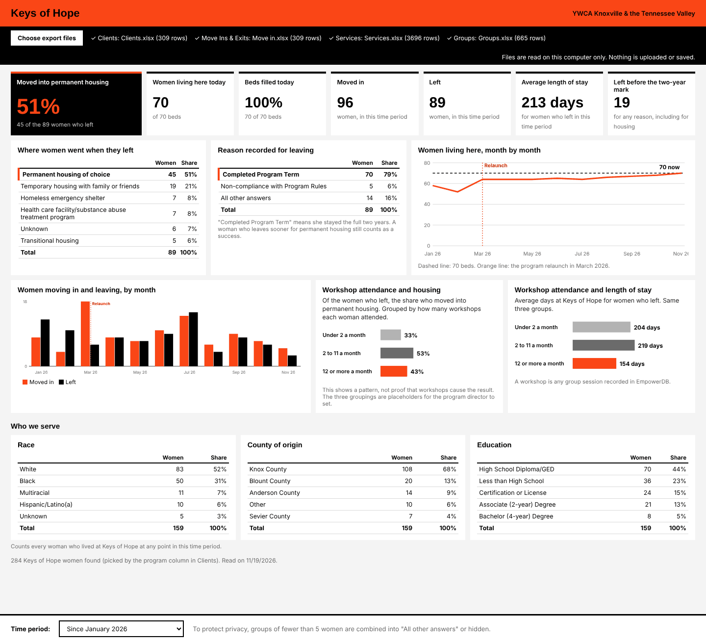
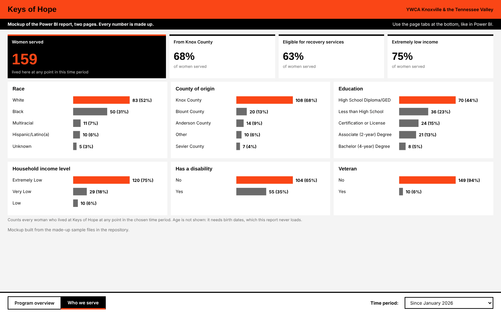
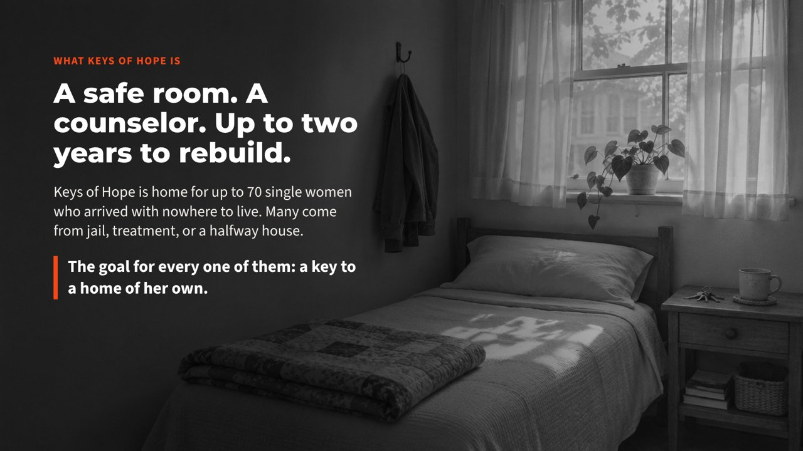

# Keys of Hope Dashboard

A staff dashboard for Keys of Hope, the residential program run by YWCA Knoxville & the Tennessee Valley. Built in one day at Hack for Nonprofits 2026.

> **Status: hackathon prototype, November 19, 2026.** It runs on made-up data. It has not been connected to any YWCA system. See [What this is not](#what-this-is-not).

<!-- TEAM: every line marked TEAM below is a fact only the team or YWCA can fill in. Do not guess. Delete this comment when none are left. -->

## What it is for

Keys of Hope gives up to 70 single women who are homeless a place to live for up to 24 months, with counseling, workshops, and links to community partners.

Today the program's numbers live in three places and are pulled together by hand. This project gives staff one page that answers: **who needs attention, and what should we do about it?**

It is for YWCA staff first: the program director, the two counselors, and the leadership team. The same numbers can later feed grant and donor reports.

## What it looks like

Every number in these pictures is made up.

**The working dashboard** (`dashboard/KeysOfHope_dashboard.html`), loaded with the sample files:

**The planned Power BI report, page 2, "Who we serve"** (a mockup, not built yet):

**The demo deck** from the hackathon presentation is in [`docs/demo/KeysOfHope_demo_deck.pptx`](docs/demo/KeysOfHope_demo_deck.pptx):

## What is in this repository

| Path | What it holds |
| --- | --- |
| `dashboard/KeysOfHope_dashboard.html` | The working prototype. One file that opens in a browser and reads EmpowerDB exports on that computer. |
| `dashboard/src/` | The page layout (`page.html`) and the logic (`app.js`), with comments |
| `dashboard/build.py` | Rebuilds the one-file dashboard after a change to `src/` |
| `dashboard/vendor/` | The Excel-reading library the page uses, with its license notice |
| `dashboard/ywca-theme.json` | YWCA colors for the planned Power BI report |
| `data/sample/` | Made-up practice files in the same shape as the real exports. No real person appears in them. |
| `docs/power-bi-build-steps.md` | Step-by-step plan for the Power BI version, with every query and formula |
| `docs/demo/KeysOfHope_demo_deck.pptx` | The eleven-slide demo deck, with speaker notes. Slides are pictures, so the text is not editable. |
| `docs/images/` | Screenshots used in this README |

## Quickstart

**Try it with made-up data**

1. Download `dashboard/KeysOfHope_dashboard.html` and the four files in `data/sample/`.
2. Open the HTML file in Chrome or Edge. No install and no internet needed.
3. Click **Choose export files** and select all four sample files at once.
4. You should see a black card reading "Left for a home of their own" with a percentage, six more number cards, and charts below.

Tested on: Chromium in an automated run on Linux, November 19, 2026, with the sample files.
<!-- TEAM: add a line once a person has run it on Windows with real exports: browser, date, who. -->

**Weekly update on a YWCA computer (real data)**

1. In EmpowerDB, open EmpowerDB Administration, then Table Export.
2. Export Clients, Move Ins & Exits, Services, and Groups to Excel. Save them in one folder.
3. Open `KeysOfHope_dashboard.html`, click **Choose export files**, and select all four.

The files are read in the browser on that computer. Nothing is uploaded. Closing the page clears the numbers.

**Changing the dashboard**

Edit `dashboard/src/app.js` or `dashboard/src/page.html`, then run `python3 dashboard/build.py`. The rules the numbers follow are listed in the comment at the top of `app.js`.

## What the dashboard shows

This list came from the discovery session with the program director on November 19, 2026. Items marked "not built" are wanted but not in the prototype.

| Question staff asked | Status |
| --- | --- |
| How many women live here now, out of 70? | Built |
| How many moved in and left, by month and by grant year? | Built |
| What share left for a home of their own? | Built |
| Where did the others go, and why did women leave? | Built |
| Do women who take part more reach permanent housing faster? | Built as a first look. The cut points for low, medium, and high are placeholders. |
| Who do we serve (race, county, education)? | Built |
| Who is coming to workshops, by core area? | Not built |
| Who is employed, and who is not yet? | Not built |
| Who is engaged in recovery support? | Not built |
| Who has kept their monthly counselor meeting? | Not built |
| Which milestones has each woman reached? | Not built |
| How many applied, and how much funding is coming in? | Not built. This is not in the EmpowerDB exports. |

**Core areas:** life skills, employment, mental and physical health.

## Where the real data lives

Nothing in this repository connects to these systems. This is a map for whoever does that work next.

| System | What it holds | Who uses it |
| --- | --- | --- |
| EmpowerDB | Services, groups, and case notes for every YWCA Knoxville department | All of YWCA Knoxville |
| KnoxHMIS | A record at entry and at exit, required by the city grant | Keys of Hope only |
| Agency spreadsheet | Monthly totals each department types in by hand | Department directors |
| Paper sign-in sheets | Workshop attendance, typed into EmpowerDB afterward | Program director |

EmpowerDB has built-in reports (services, groups, program census, average length of stay). Those exports are the likely way in. Nobody has tested that yet.

## Data rules

These are not optional.

- **No real resident data in this repository. Ever.** Not in a commit, a screenshot, an issue, or a test file. Git history keeps what you delete.
- **Made-up data only** for development and demos.
- **IDs, never names.** No birth dates, Social Security numbers, addresses, room numbers, or case notes.
- **Hide small groups.** Any count from 1 to 4 shows as "Fewer than 5", so a number cannot point to one woman.
- **Real data is loaded by YWCA staff, inside YWCA's own systems.** Not on a volunteer's laptop.

The KnoxHMIS Privacy Notice (version October 24, 2024) allows de-identified information to be used for reporting to funders and the public, with no names, dates of birth, or other identifying information beyond a numeric client ID. That is the line this project stays behind.

If you find real data in this repository, tell the owner right away. Do not just delete the file: the history has to be cleaned too.

## What this is not

- **Not connected to live data.** Every number in the prototype is invented.
- **Not a resident-facing tool.** A view for each woman to see her own progress was discussed and set aside for later.
- **Not a replacement for EmpowerDB or KnoxHMIS.** Staff still enter data where they do today.
- **Not proof of anything about the real program.** The practice data has a pattern planted in it so charts have something to show.
- **Not reviewed** by YWCA's privacy, legal, or IT contacts.

## Who owns what

The hackathon asks every team to name owners before leaving.

| What | Owner |
| --- | --- |
| The dashboard after the event | YWCA Knoxville's Director of Social Services |
| This repository | TEAM |
| Loading real data | YWCA staff only |
| Follow-up meeting within two weeks | TEAM: date and who schedules it |

## Next steps

**Next**

- Check the prototype's numbers against real EmpowerDB exports, done by YWCA staff on a YWCA computer.
- Build the Power BI version from `docs/power-bi-build-steps.md`. Power BI is what the rest of YWCA reports in.
- Have the program director set the low, medium, and high levels for taking part.
- Add applications and funding, which live outside EmpowerDB today.
- Replace paper workshop sign-in sheets and paper room assignments.

**Later**

- A view for counselors to follow one woman's progress.
- Tabs for YWCA's other program departments.
- A refresh that runs by itself, daily, in place of the Friday export.

<!-- TEAM: add the top 3 fixes from the 2:45 test with the program director. Anything else found today goes here too. -->

## Team

Built by a volunteer team with YWCA Knoxville's Director of Social Services as the problem owner.

| Role | Did what |
| --- | --- |
| Problem owner (YWCA) | Made the decisions and tested the prototype |
| Design lead | Ran discovery and wireframed the dashboard |
| Developer | Set up the repository and the data template |
| Team coach | Kept scope and time, built the dashboard |

No one is named here on purpose. Ask before adding anyone.

Hack for Nonprofits 2026 is run by 121 Tech Hub and United Way of Greater Knoxville.

## License

TEAM: choose one, or say "All rights reserved" until YWCA decides. No license means nobody else may reuse this.
